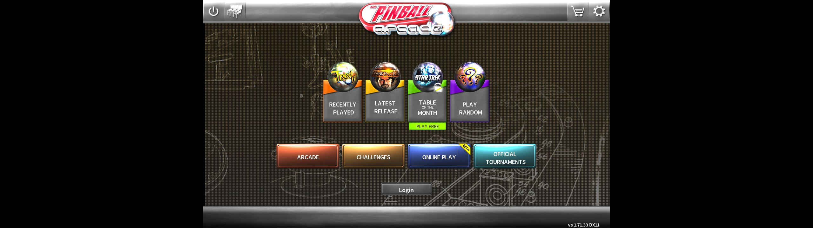

# Pinball Arcade - Modern Systems Fix

A fix that makes The Pinball Arcade (PC, Steam) play properly on modern computers. It is a
single DLL you drop into the game folder: no game files are edited, and deleting the DLL puts the
game back exactly as it was.

## What it fixes
- **Game speed (DX11).** The ball moved far too fast on high-refresh monitors: 2x speed at
  120 Hz, 4x at 240 Hz. The game is held to the 60 fps its physics were made for.
- **Screen resolution.** The game opened in a small window in the corner of the screen that
  couldn't be moved, and its settings tool didn't list modern resolutions. It now runs
  fullscreen on any monitor with the picture kept 16:9 and black bars at the sides (or top and
  bottom), or in a proper centred window. It renders at full resolution, so nothing is
  stretched, and stays sharp with Windows display scaling.
- **Frozen "Press Start" screen and slow loading (DX11).** The title screen ignored the keyboard
  and mouse for 20-45 seconds after it appeared, and tables took about 25 seconds to load. Now
  the title responds after about a second and tables load in about 3 seconds.
- **Start-up focus.** The game could sit frozen on the title screen until you alt-tabbed away
  and back.
- **Broken settings tool.** The Launch Configuration Utility crashes on a fresh install. It is
  replaced by a settings window built into the fix, which opens when the game starts.
- **Small menu background (DX9).** The moving blueprint background in the menus was a small box
  in the corner instead of filling the screen.
- **Stuck high-score box.** An original game bug: after entering initials on some tables
  (reproduced on Teed Off), the on-screen letter-select box stayed up into the next game and took
  over the flipper keys until the table was reloaded. The fix closes it.

Gameplay, physics, tables and graphics are otherwise unchanged.

## Install
1. Copy `bin\xinput1_3.dll` into the game folder, next to `PinballArcade.exe`. For Steam that is
   `<Steam library>\steamapps\common\PinballArcade\`.
   Optionally copy `bin\PinballArcadeFix.ini` too; it documents every setting, but the settings
   window creates it for you.
2. Start the game from Steam. Steam asks which version to run: pick the **DX11** option and tick
   Steam's box to remember the choice. From then on the game goes straight to the fix's settings
   window, and you never see the old Launch Configuration Utility again. You can still switch to
   DX9 in the settings window.

**Uninstall:** delete `xinput1_3.dll` (and `PinballArcadeFix.ini` / `PinballArcadeFix.log` if
present) from the game folder.

**Supported version:** the final Steam build (game version 1.71, Steam build 5650517, October
2020) of `PinballArcade11.exe` (DX11) and `PinballArcade.exe` (DX9). The fix checks the exe
before changing anything; on any other build it does nothing and says so in its log. The cabinet
version (`PinballArcadeCabinet.exe`) is not supported.

## Settings window
Opens when the game starts, before the game loads its settings, whichever version Steam starts:

- **Renderer**: DirectX 11 (recommended) or DirectX 9. If Steam started the other version, the
  fix restarts the game in the one chosen here.
- **Display**: *Fullscreen 16:9 with black bars* or *Windowed 16:9* (a normal window at 75% of
  the fullscreen size, 1920x1080 on a 2560x1440 or 5120x1440 screen, centred; it can be moved
  and minimised but not resized).
- **Anti-aliasing**, **Texture filtering**, **Post-processing (DX9)**, **Ball reflection (DX9)**,
  **Ball brightening (DX11)**, **Language**, and **When the game is in the background** (ignore
  or keep reading keyboard and controller input): the game's own graphics and input settings,
  which the old settings tool used to set. They are written to the game's settings files in the
  same format the old tool used.
- **Show this window every time the game starts**: untick to start straight away with your
  saved settings. Hold **Shift** while the game starts to bring the window back.
- **Play** starts the game; **Quit** cancels the launch.

Resolution isn't a choice any more: the fix uses your monitor's current desktop resolution.

## Settings file
Everything is stored in `PinballArcadeFix.ini` in the game folder. The settings window covers the
normal options; `bin\PinballArcadeFix.ini` lists them all with explanations, including a few
extras (`AspectRatio`, `FrameRateCap`). The game's own settings stay where the game keeps them,
in `Documents\..\My Games\Pinball Arcade\` (`settings.dat`, `dx11_settings.dat`).

## Troubleshooting
The fix writes `PinballArcadeFix.log` in the game folder each time the game starts: what it
hooked, the window size it chose, and a frame-timing line every 10 seconds. If something doesn't
work, that log shows what happened.

- **Steam's "Launch Configuration Utility" crashes.** That's the game's original tool (see below);
  use the fix's settings window instead.

## What was wrong, and what the fix does
`xinput1_3.dll` is loaded by the game at start-up (it's the controller library). The fix passes
every controller call through to the real Windows `xinput1_3.dll` and patches the game in memory.
All addresses below are in the supported build.

### Game speed and pacing (DX11)
- `PinballArcade11.exe` advances the simulation by a fixed 16 ms for every frame it draws
  (frame timer at `0x49D7B0`) and has no frame cap; it presents every monitor refresh
  (`Present(1)` at `0x73DB19`). On a 60 Hz monitor that was real time; at 120 Hz it is double
  speed. The DX9 build has its own 60 fps busy-wait and was fine.
- The fix hooks the frame timer and holds each frame to 1/60 s with a high-resolution timer, and
  takes over the `Present` call to limit DXGI's frame queue to one frame, which keeps input lag
  low. Measured: a steady 16.67 ms per frame.

### Loading (DX11)
- The game streams its data one chunk per frame, and the title screen only accepts input once its
  start-up loading is done. At 60 fps that made the title seem frozen for 20-45 seconds and table
  loads take about 25 seconds.
- During start-up, the cap is lifted until disk reads stop and you press a key, button or
  controller button (20 second limit). For later loads, it is lifted while at least 12 of the
  last 16 frames read from disk, and restored after 8 frames without reads. Gameplay itself reads
  nothing from disk (measured), so a table in play is never sped up.

### Screen resolution (both builds)
- DX11 creates a normal window from its saved position and size (by default at 0,0 with the
  title bar off-screen) and sizes its swap chain to the window. DX9 opens 640x480 by default,
  picks its render size from a preset table and moves its own window.
- The fix hooks the game's `CreateWindowExA` and makes the game window either borderless at the
  largest 16:9 size that fits the monitor, with a black full-screen window behind it for the
  bars, or a normal centred window. The game renders at the window's size. For DX9 it also hooks
  the set-display-mode function (`0x5BA5A0`) to use that size, keeps the game out of exclusive
  fullscreen, pins `MoveWindow`, and updates the screen size the menus use (the moving menu
  background is drawn as a square 1.2x the screen's larger side, from a size saved at window
  creation, `0xD41A10`; left at 640x480 it was a 768x768 box).
- The process is marked per-monitor DPI aware, so Windows display scaling can't blur it.
- The old tool's DX11 "Fullscreen" setting switches the game to a path that draws a fixed-size
  picture into the corner of the window; the fix makes the game ignore that setting, and blocks
  Alt+Enter, the game's own toggle into it.

### Start-up focus
The DX11 game only runs its title screen once Windows tells it its window is active. When Steam
starts the game, Windows can refuse to bring the new window to the front. The fix makes sure the
game window takes focus when it first appears.

### Settings tool
`PBAConfig.exe` (the Launch Configuration Utility) shows number fields for arcade-cabinet screen
layouts that are blank on a fresh install, and crashes reading them when you press Done. Its
DX11 resolution list also stops at 4096 wide. The fix's settings window replaces it: it runs at the
game's entry point, before the game reads its settings, and writes `settings.dat` and
`dx11_settings.dat` in the same formats `PBAConfig.exe` used (cabinet settings are left alone).

### Stuck high-score box
The game opens its letter-select box (GUI menu `0x23`) while a table's display shows that the
table wants initials. Only some table types contain the code that closes it again afterwards. If
the box is still open half a second after the game has finished with initials, the fix closes it
with the game's own "back to previous menu" function. Players reported this bug years ago, on
tables such as Cactus Jack's and Black Knight 2000.

## Verified
Tested on Windows 11 with a 5120x1440 120 Hz monitor:

- DX11 speed: steady 60 fps (16.67 ms frames), play-tested.
- Fullscreen and windowed, DX9 and DX11: correct 16:9 picture at native resolution (2560x1440
  fullscreen, 1920x1080 windowed), menus and tables play-tested.
- DX11 title screen accepts the first click or key about 1 second after it appears; tables load
  in about 3 seconds; play-tested.
- Settings window: writes settings both builds read (play-tested from Steam); Renderer switch
  tested both ways outside Steam.
- Stuck high-score box: reproduced on Teed Off (DX11) and closed by the fix; normal high-score
  entries are left alone. The DX9 version of this fix uses the same logic, with its addresses
  checked against the running game, but hasn't been seen closing a stuck box yet.

## Limitations
- Steam still lists the old Launch Configuration Utility. Removing it would mean changing the
  game's files; ticking Steam's "remember my choice" hides it.
- The fix uses the primary monitor, and reads the desktop resolution when the game starts.
- Online features that depended on FarSight's servers are not covered.

## Build
Run `build.cmd` (needs Visual Studio with "Desktop development with C++"; it builds a 32-bit DLL).
Output: `bin\xinput1_3.dll`.

## Files
- `src\` - the DLL source: `PinballFix.cpp` (entry, logging, speed/pacing/loading fixes, stuck
  high-score box), `Display.cpp` (fullscreen/windowed, DX9 resolution, focus), `Launcher.cpp`
  (settings window logic and game settings files), `LauncherUI.cpp` (reusable CerealCommitter
  launcher window), `proxy_xinput.cpp` + `xinput1_3.def` (pass-through to the real
  `xinput1_3.dll`), `resources.rc` (embedded logo).
- `bin\` - the built DLL and a commented settings file.
- `assets\` - the logo embedded in the DLL.
- `screenshots\` - the images in this README.
- `LICENSE` - MIT license.

## License
The code is released under the [MIT License](LICENSE): you can use, modify and share it, as long as
the copyright notice stays with it. It comes with no warranty.

Not covered by the license:
- The CerealCommitter logo (`assets\logo.png` and the copy built into `xinput1_3.dll`). It
  remains © CerealCommitter; if you reuse the code, use your own logo.
- The screenshots in `screenshots\`, which show the game. The Pinball Arcade is © FarSight
  Studios; the tables and their names are trademarks of their respective owners.
